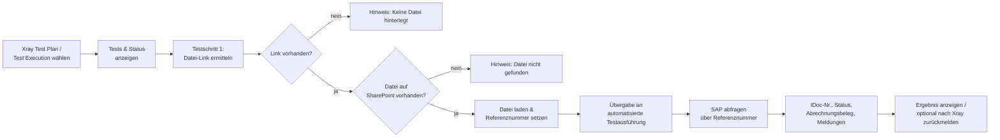
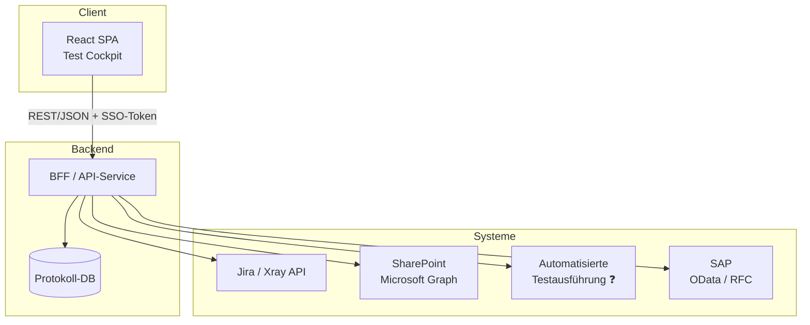

# Test Cockpit – Konzept

> Status: Entwurf · Stand: 09.11.2026
> Mit ❓ markierte Punkte sind offen und müssen noch geklärt werden (siehe [Kapitel 10](#10-offene-fragen)).

---

## 1. Ziel und Kontext

Das **Test Cockpit** ist eine Webanwendung auf Basis von React. Sie bündelt die Durchführung und Nachverfolgung von EDI-basierten Tests an einem Ort.

Heute liegen die Informationen an verschiedenen Stellen:

| Information | System |
|---|---|
| Testplanung, Testfälle, Ausführungen | Jira / **Xray** (Test Plans, Test Executions) |
| Testdateien (EDI-Dateien) | **SharePoint** |
| Ergebnis der Verarbeitung (IDoc, Beleg, Meldungen) | **SAP** |
| Technische Ausführung | Automatisierte Testausführung ❓ |

Das Cockpit soll diese Informationen zusammenführen und den Ablauf von der Testauswahl bis zur Ergebnisprüfung im SAP in **einer Oberfläche** abbilden.

---

## 2. Begriffe

| Begriff | Bedeutung |
|---|---|
| **Xray Test Plan** | Fasst Tests für ein Testziel zusammen (z. B. ein Release) |
| **Xray Test Execution** | Konkrete Ausführung einer Menge von Tests; enthält pro Test einen **Test Run** mit Status und Schritten |
| **Testschritt 1** | Erster Schritt eines Tests. Hier steht der Link auf die EDI-Testdatei. |
| **EDI-Datei** | Reine Textdatei nach dem **EDI-Schema** (Segment- bzw. Satzstruktur) mit den Nutzdaten für SAP |
| **Referenznummer** | Eindeutige Kennung, die das Cockpit vor der Übergabe in die EDI-Datei schreibt. Damit lässt sich der Beleg später in SAP finden. |
| **IDoc** | SAP-Zwischenbeleg, in dem eingehende EDI-Nachrichten verarbeitet werden. Hat eine IDoc-Nummer und einen Status. |
| **Abrechnungsbeleg** | Der Folgebeleg in SAP, der aus dem IDoc entsteht |
| **Meldungen** | Status- und Fehlermeldungen aus der IDoc- bzw. Belegverarbeitung |

---

## 3. Fachlicher Ablauf



1. **Testübersicht laden:** Die Nutzerin oder der Nutzer wählt einen Xray Test Plan oder eine Test Execution. Das Cockpit zeigt alle enthaltenen Tests mit ihrem aktuellen Status.
2. **Datei ermitteln:** Für jeden Test liest das Cockpit den **ersten Testschritt** (Action, Data oder Anhang) und holt den Link zur EDI-Datei heraus.
3. **Prüfen:**
   - Ist überhaupt ein Link hinterlegt?
   - Gibt es die Datei unter diesem Link auf dem **SharePoint** wirklich?
4. **Datei vorbereiten:** Das Cockpit lädt die Datei, erzeugt eine **Referenznummer** und schreibt sie an die richtige Stelle im EDI-Schema. Die übrigen Inhalte bleiben unverändert.
5. **Übergabe:** Das Cockpit übergibt die angepasste Datei an die automatisierte Testausführung und stößt diese an.
6. **SAP-Abfrage:** Nach dem Start fragt das Cockpit SAP über die Referenznummer ab:
   - IDoc-Nummer und IDoc-Status
   - Nummer des Abrechnungsbelegs
   - später auch Meldungen und Fehlerhinweise
7. **Ergebnis:** Das Cockpit zeigt das Ergebnis pro Test an. Optional schreibt es den Status nach Xray zurück.

---

## 4. Funktionale Anforderungen

### MVP (Phase 1)

| ID | Anforderung |
|---|---|
| F-01 | Xray Test Plans und Test Executions suchen und auswählen (z. B. nach Projekt, Key, Fix Version) |
| F-02 | Tests einer Execution mit Status anzeigen (TODO, EXECUTING, PASS, FAIL …), filtern und sortieren |
| F-03 | Datei-Link aus Testschritt 1 herauslesen |
| F-04 | Fehlenden Link pro Test anzeigen |
| F-05 | Existenz der Datei auf SharePoint prüfen und das Ergebnis anzeigen (✅ / ⚠️ / ❌) |
| F-06 | Gesamtübersicht (Dashboard): Anzahl Tests, Status-Verteilung, Tests mit fehlenden Dateien |

### Phase 2 – Ausführung

| ID | Anforderung |
|---|---|
| F-07 | EDI-Datei parsen und Referenznummer setzen (schemakonform) |
| F-08 | Vorschau bzw. Diff der angepassten Datei vor der Übergabe |
| F-09 | Übergabe an die automatisierte Testausführung, einzeln und als Sammelauswahl |
| F-10 | Ausführungsstatus nachverfolgen (übergeben → läuft → abgeschlossen) |
| F-11 | Protokoll: welche Datei mit welcher Referenz wann von wem übergeben wurde |

### Phase 3 – SAP-Auswertung

| ID | Anforderung |
|---|---|
| F-12 | SAP über die Referenznummer abfragen: IDoc-Nummer und IDoc-Status |
| F-13 | Abrechnungsbelegnummer ermitteln und anzeigen |
| F-14 | Status- und Fehlermeldungen aus SAP anzeigen |
| F-15 | Optional: Ergebnis als Test-Run-Status bzw. Kommentar nach Xray zurückschreiben |
| F-16 | Optional: Abfrage automatisch wiederholen (Polling), bis ein Endstatus erreicht ist |

---

## 5. Architektur

Das React-Frontend spricht die Fremdsysteme **nicht direkt** an. Ein **Backend-for-Frontend (BFF)** liegt dazwischen. Gründe:

- Zugangsdaten (Xray Client Secret, SAP-Technikuser, Graph-Secrets) gehören nicht in den Browser.
- So gibt es keine CORS-Probleme mit Jira/Xray, SharePoint und SAP.
- Dateien werden zentral bearbeitet (EDI-Parsing, Referenz setzen) und protokolliert.



### Module im Backend

| Modul | Aufgabe |
|---|---|
| `xray-connector` | Test Plans, Executions, Test Runs und Testschritte lesen; Status zurückschreiben |
| `sharepoint-connector` | Link auflösen, Existenz prüfen, Datei laden |
| `edi-module` | EDI-Datei parsen, Referenznummer setzen, prüfen (Validierung) |
| `execution-connector` | Übergabe an die Testausführung und Status abfragen |
| `sap-connector` | IDoc, Abrechnungsbeleg und Meldungen über die Referenz abfragen |
| `audit` | Übergaben und Ergebnisse protokollieren |

---

## 6. Technische Rahmenbedingungen

### 6.1 Frontend

- **React** mit **TypeScript**, Build mit **Vite**
- UI-Bibliothek ❓ (z. B. MUI oder Fluent UI; ggf. Kunden-/RPS-Styleguide)
- Datenabfragen mit **TanStack Query** (Caching und Polling für Status)
- Routing mit React Router; Tabellen mit TanStack Table oder einem Grid der UI-Bibliothek
- Anmeldung per **SSO über Microsoft Entra ID** (MSAL), da SharePoint ohnehin im M365-Umfeld liegt ❓

### 6.2 Backend (BFF)

- Node.js (TypeScript, z. B. NestJS oder Fastify) **oder** .NET ❓ – je nach Teamkompetenz und Betriebsumgebung
- Secrets in einem Secret Store (z. B. Azure Key Vault, GitLab CI Variables), nie im Code
- Kleine Datenbank für das Protokoll (z. B. PostgreSQL oder SQLite im MVP)

### 6.3 Xray

- **Xray Cloud oder Xray Server/Data Center?** ❓ Davon hängt die API ab:
  - *Cloud:* GraphQL-API (`xray.cloud.getxray.app/api/v2/graphql`), Anmeldung mit Client ID und Secret
  - *Server/DC:* REST-API (`/rest/raven/…`) mit Jira-Anmeldung (PAT/Technikuser)
- Es muss feststehen, **wo im Testschritt 1 der Link steht**: Feld *Action*, *Data*, *Expected Result*, Anhang oder ein eigenes Feld ❓
- Rate Limits der API beachten, Ergebnisse zwischenspeichern (Caching)

### 6.4 SharePoint

- Zugriff über die **Microsoft Graph API**
- Eine App-Registrierung in Entra ID ist nötig, möglichst mit der Berechtigung `Sites.Selected` (nur die freigegebenen Sites)
- Sharing-Links in Drive Items auflösen (`/shares/{encoded-url}/driveItem`) oder über Site, Drive und Pfad zugreifen
- Prüfen, ob die Datei existiert; Metadaten anzeigen (Name, Größe, geändert am)

### 6.5 EDI-Schema

- Die EDI-Datei ist eine **reine Textdatei**. Das Format ist noch zu klären ❓: EDIFACT (z. B. INVOIC, DESADV), ein kundeneigenes Flatfile oder ein IDoc-Flatfile.
- Für die Referenznummer muss feststehen:
  - **In welches Segment bzw. Feld** sie geschrieben wird
  - Wie die **Referenz aufgebaut** ist (Präfix, Länge, Zeichensatz), z. B. `TC-<Execution>-<Lfd.Nr.>`
  - Ob sie **eindeutig** sein muss und welche Felder sonst noch angepasst werden müssen (Datum, Kontrollnummern wie UNB/UNH, Segmentzähler UNT)
- Zeichensatz und Zeilenenden (z. B. ISO-8859-1 oder UTF-8, CRLF) müssen **genau erhalten** bleiben
- Das Parsing soll mit **Tests auf Basis realer Beispieldateien** abgesichert werden

### 6.6 Automatisierte Testausführung

- Zielsystem ❓: z. B. ein Upload-Verzeichnis oder SFTP für das EDI-Subsystem, eine CI-Pipeline (GitLab), ein Testautomatisierungs-Tool oder ein direkter SAP-Eingang
- Schnittstelle ❓: Dateiablage, REST-Aufruf oder Pipeline-Trigger
- Über welchen Rückkanal kommt der Ausführungsstatus? (Polling, Webhook)

### 6.7 SAP

- Zugriffsweg ❓:
  - **OData-Service** über SAP Gateway (bevorzugt für eine Web-Integration) oder
  - **RFC/BAPI** über eine Middleware (z. B. SAP Cloud Connector, node-rfc, SAP CPI)
- Die fachliche Abfrage läuft über die **Referenznummer**:
  - IDoc-Kontrollsatz (EDIDC) und IDoc-Status (EDIDS), z. B. Status 53 = verbucht, 51 = Fehler
  - Verknüpfung zum Folgebeleg bzw. Abrechnungsbeleg
  - Meldungen aus dem IDoc-Status oder dem Anwendungs-Log
- Welches SAP-System bzw. welcher Mandant (Testsystem) angebunden wird, ist noch offen ❓
- Gibt es schon einen passenden Service oder muss **ein Z-Service gebaut werden**? ❓
- Für die Abfrage reicht ein Technikuser mit **reinen Leserechten**

### 6.8 Betrieb und Sicherheit

- Hosting ❓: z. B. RPS-Infrastruktur, Kundenumgebung, Azure oder Kubernetes
- Netzwerkzugang vom Backend zu SAP und zum EDI-Eingang (VPN, Firewall-Freigaben) ❓
- CI/CD über **GitLab** (`git.realcore.services`)
- Protokollierung ohne sensible Inhalte; mit Testdaten aus EDI-Dateien sorgsam umgehen (Datenschutz)
- Berechtigungen im Cockpit: Lesen für alle, Übergabe nur für berechtigte Rollen ❓

---

## 7. Datenmodell (Entwurf)

```ts
interface TestCockpitItem {
  executionKey: string;        // z. B. "PROJ-1234"
  testKey: string;             // z. B. "PROJ-987"
  testSummary: string;
  xrayStatus: string;          // TODO | EXECUTING | PASS | FAIL | ...
  fileLink?: string;           // aus Testschritt 1
  fileCheck: 'missing-link' | 'not-found' | 'found' | 'unchecked';
  reference?: string;          // vom Cockpit vergeben
  submission?: {
    submittedAt: string;
    submittedBy: string;
    status: 'submitted' | 'running' | 'done' | 'error';
  };
  sap?: {
    idocNumber?: string;
    idocStatus?: string;       // z. B. "53"
    billingDocument?: string;  // Abrechnungsbeleg
    messages?: { type: 'E' | 'W' | 'I' | 'S'; text: string }[];
  };
}
```

---

## 8. Oberflächen (Skizze)

1. **Startseite / Auswahl:** Test Plan oder Execution suchen; zuletzt verwendete Einträge
2. **Execution-Übersicht:** Tabelle der Tests mit diesen Spalten:
   - Test, Xray-Status, Datei-Link, SharePoint-Prüfung, Referenz, Ausführungsstatus, IDoc, Abrechnungsbeleg
   - Mehrfachauswahl und die Aktion „Übergeben“
3. **Testdetail:** Testschritte, Dateivorschau mit markierter Referenz, Verlauf, SAP-Ergebnis und Meldungen
4. **Dashboard:** Status-Verteilung, offene Probleme (fehlende Dateien, Fehler-IDocs)

---

## 9. Vorgehen und Meilensteine

| Phase | Inhalt | Ergebnis |
|---|---|---|
| 0 | Fragen klären, Zugänge besorgen (Xray, Graph, SAP), Beispiel-EDI-Dateien sammeln | Technischer Durchstich ist möglich |
| 1 | MVP: Xray-Übersicht und Datei- bzw. SharePoint-Prüfung (F-01 bis F-06) | Nur lesend, sofort nutzbar |
| 2 | EDI-Modul und Übergabe an die Testausführung (F-07 bis F-11) | Tests aus dem Cockpit anstoßen |
| 3 | SAP-Abfrage (F-12 bis F-14) | Ende-zu-Ende-Sicht pro Test |
| 4 | Rückmeldung nach Xray, Polling, Meldungen ausbauen (F-15, F-16) | Testläufe weitgehend automatisch nachverfolgen |

---

## 10. Offene Fragen

1. Wird **Xray Cloud oder Server/DC** eingesetzt? Welches Jira-Projekt? Wer stellt den API-Zugang?
2. **Wo genau** steht der Datei-Link im ersten Testschritt? Gibt es ein festes Format?
3. Welches **EDI-Format** wird verwendet? Gibt es eine Spezifikation? In welches **Feld** kommt die Referenznummer, und wie ist sie aufgebaut?
4. Welche **SharePoint-Site(s)** sind betroffen? Wer genehmigt die App-Registrierung (Kunden-IT)?
5. Was genau ist die **automatisierte Testausführung**? Über welche Schnittstelle wird übergeben, und wie kommt der Status zurück?
6. Welches **SAP-System bzw. welcher Mandant**? Gibt es OData oder RFC-Zugang? Muss ein eigener Service gebaut werden?
7. Wo wird die Referenznummer in SAP abgelegt, sodass man danach suchen kann (z. B. IDoc-Kontrollsatz, Segmentfeld, Belegreferenz)?
8. **Hosting**, Netzwerkzugänge und Anmeldung (Entra ID SSO)?
9. Soll der Status **nach Xray zurückgeschrieben** werden, und wenn ja, automatisch oder erst nach Bestätigung?
10. Wer benutzt das Cockpit, und welche Rollen und Rechte braucht es?
