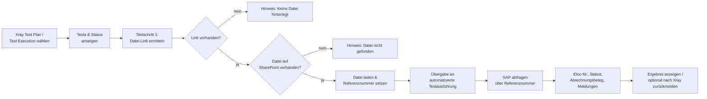
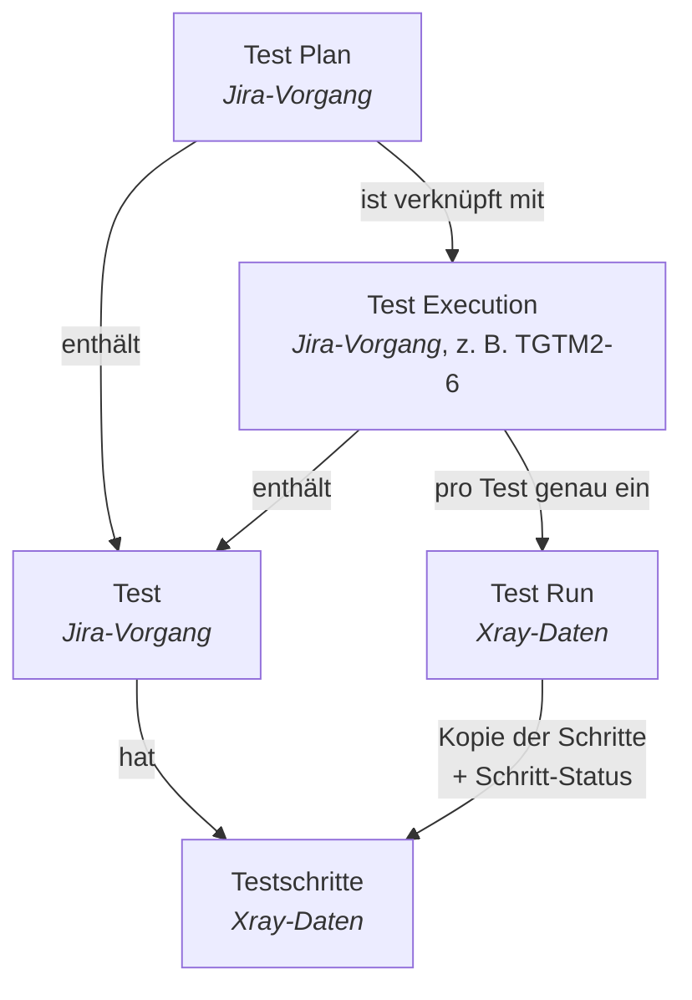
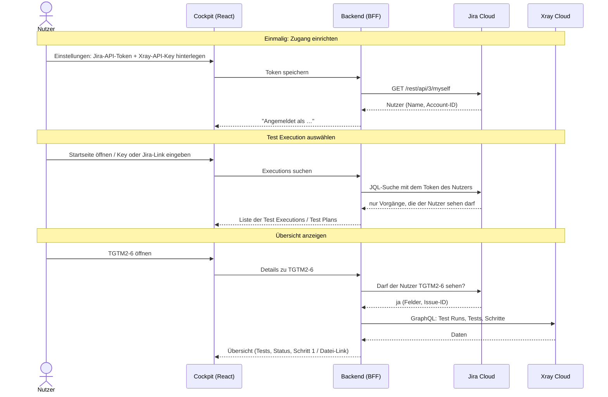
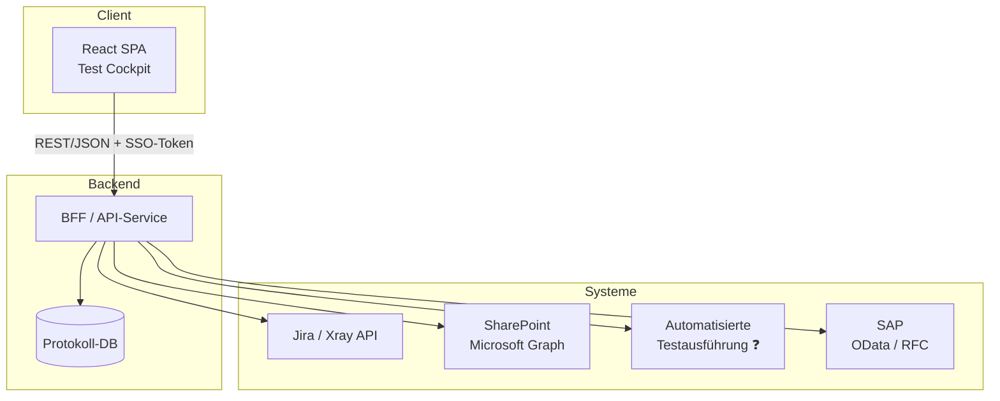

# Test Cockpit – Konzept

> Status: Entwurf · Stand: 09.11.2026
> Mit ❓ markierte Punkte sind offen und müssen noch geklärt werden (siehe [Kapitel 12](#12-offene-fragen)).

---

## 1. Ziel und Kontext

Das **Test Cockpit** ist eine Webanwendung auf Basis von React. Sie bündelt die Durchführung und Nachverfolgung von EDI-basierten Tests an einem Ort.

Heute liegen die Informationen an verschiedenen Stellen:

| Information | System |
|---|---|
| Testplanung, Testfälle, Ausführungen | Jira / **Xray** (Test Plans, Test Executions) |
| Testdateien (EDI-Dateien) | **SharePoint** |
| Ergebnis der Verarbeitung (IDoc, Beleg, Meldungen) | **SAP** |
| Technische Ausführung | Automatisierte Testausführung ❓ |

Das Cockpit soll diese Informationen zusammenführen und den Ablauf von der Testauswahl bis zur Ergebnisprüfung im SAP in **einer Oberfläche** abbilden.

---

## 2. Begriffe

| Begriff | Bedeutung |
|---|---|
| **Xray Test Plan** | Fasst Tests für ein Testziel zusammen (z. B. ein Release) |
| **Xray Test Execution** | Konkrete Ausführung einer Menge von Tests; enthält pro Test einen **Test Run** mit Status und Schritten |
| **Testschritt 1** | Erster Schritt eines Tests. Hier steht der Link auf die EDI-Testdatei. |
| **EDI-Datei** | Reine Textdatei nach dem **EDI-Schema** (Segment- bzw. Satzstruktur) mit den Nutzdaten für SAP |
| **Referenznummer** | Eindeutige Kennung, die das Cockpit vor der Übergabe in die EDI-Datei schreibt. Damit lässt sich der Beleg später in SAP finden. |
| **IDoc** | SAP-Zwischenbeleg, in dem eingehende EDI-Nachrichten verarbeitet werden. Hat eine IDoc-Nummer und einen Status. |
| **Abrechnungsbeleg** | Der Folgebeleg in SAP, der aus dem IDoc entsteht |
| **Meldungen** | Status- und Fehlermeldungen aus der IDoc- bzw. Belegverarbeitung |

---

## 3. Fachlicher Ablauf



1. **Testübersicht laden:** Die Nutzerin oder der Nutzer wählt einen Xray Test Plan oder eine Test Execution. Das Cockpit zeigt alle enthaltenen Tests mit ihrem aktuellen Status.
2. **Datei ermitteln:** Für jeden Test liest das Cockpit den **ersten Testschritt** (Action, Data oder Anhang) und holt den Link zur EDI-Datei heraus.
3. **Prüfen:**
   - Ist überhaupt ein Link hinterlegt?
   - Gibt es die Datei unter diesem Link auf dem **SharePoint** wirklich?
4. **Datei vorbereiten:** Das Cockpit lädt die Datei, erzeugt eine **Referenznummer** und schreibt sie an die richtige Stelle im EDI-Schema. Die übrigen Inhalte bleiben unverändert.
5. **Übergabe:** Das Cockpit übergibt die angepasste Datei an die automatisierte Testausführung und stößt diese an.
6. **SAP-Abfrage:** Nach dem Start fragt das Cockpit SAP über die Referenznummer ab:
   - IDoc-Nummer und IDoc-Status
   - Nummer des Abrechnungsbelegs
   - später auch Meldungen und Fehlerhinweise
7. **Ergebnis:** Das Cockpit zeigt das Ergebnis pro Test an. Optional schreibt es den Status nach Xray zurück.

---

## 4. Prozessablauf und App-Aufbau (Phase 1)

In der ersten Ausbaustufe fragt das Cockpit eine Test Execution bzw. einen Test Plan aus Xray ab und stellt sie **nur lesend** in einer Übersicht dar.
Beispiel im Testsystem: `TGTM2-6` (Test Execution zu einem Test Plan).

### 4.1 Struktur der Daten in Xray

Test Plan, Test Execution und Test sind **Jira-Vorgangstypen**. Testschritte und Test Runs sind dagegen **keine** Jira-Vorgänge. Sie sind Daten, die das Xray-Plugin selbst verwaltet.



| Element | Jira-Vorgang? | Wo liegen die Daten? | Zugriff |
|---|---|---|---|
| Test Plan | ja | Felder in Jira; enthaltene Tests und Executions in Xray | Jira REST + Xray API |
| Test Execution | ja | Felder in Jira; enthaltene Tests und Test Runs in Xray | Jira REST + Xray API |
| Test | ja | Felder in Jira; Testtyp und Schritte in Xray | Jira REST + Xray API |
| Testschritt | nein | nur Xray (Action, Data, Expected Result, Anhänge) | nur Xray API |
| Test Run | nein | nur Xray (Status, Schritt-Status, Kommentare, Anhänge, Defects) | nur Xray API |

**Folge:** Über die normale Jira-REST-API sind Testschritte und Run-Status **nicht** erreichbar. Dafür braucht es die Xray-API (siehe [Kapitel 5](#5-zugriff-auf-jira-und-xray)).

**Hinweis zum Datei-Link:** Beim Anlegen einer Test Execution kopiert Xray die Schritte des Tests in den Test Run. Ändert jemand den Test später, unterscheiden sich die beiden Stände. Das Cockpit sollte den Link deshalb aus **Schritt 1 des Test Runs** lesen, denn das ist der Stand, der tatsächlich ausgeführt wird. Fehlt er dort, nimmt es Schritt 1 des Tests ❓.

### 4.2 Prozessablauf



1. **Zugang einrichten (einmalig):** Der Nutzer hinterlegt in den Einstellungen sein Jira-API-Token und seinen persönlichen Xray-API-Key. Das Cockpit prüft beides sofort und zeigt an, mit welchem Konto er angemeldet ist.
2. **Einstieg:** Die Startseite zeigt die Test Executions und Test Plans, die der Nutzer sehen darf. Er kann sie nach Projekt, Key, Fix Version oder Text filtern. Alternativ fügt er einen Key oder einen kompletten Jira-Link ein; das Cockpit liest den Key dann aus dem Link heraus.
3. **Test Plan → Executions:** Wählt der Nutzer einen Test Plan, zeigt das Cockpit die zugehörigen Test Executions zur Auswahl.
4. **Übersicht einer Test Execution:**
   - Kopf: Key, Titel, Status, zugehöriger Test Plan, Fix Version, Testumgebung, Fortschritt (Anteil PASS/FAIL/TODO …)
   - Tabelle: ein Eintrag pro Test Run mit Test-Key, Titel, Run-Status, Datei-Link aus Schritt 1, Anzahl Schritte, zuletzt ausgeführt von / am
5. **Testdetail:** Alle Schritte mit Action, Data, Expected Result und Schritt-Status, dazu ein Link zum Vorgang in Jira.
6. In Phase 1 schreibt das Cockpit **nichts** nach Jira oder Xray zurück.

### 4.3 Aufbau der App

**Seiten**

| Seite | Route | Inhalt |
|---|---|---|
| Einstellungen | `/einstellungen` | E-Mail + Jira-API-Token sowie Xray Client ID + Client Secret hinterlegen, prüfen, löschen; angemeldeter Nutzer; Ablaufdatum des Tokens |
| Start / Auswahl | `/` | Suche und Liste der Test Executions und Test Plans; zuletzt geöffnete Einträge |
| Test Plan | `/plans/:key` | Zugehörige Test Executions |
| Execution-Übersicht | `/executions/:key` | Kopfbereich und Tabelle der Test Runs |
| Testdetail | `/executions/:key/tests/:testKey` | Schritte, Schritt-Status, Datei-Link |

Ohne gültigen Zugang leitet jede Seite auf die Einstellungen um.

**Projektstruktur (Entwurf)**

```text
xray-test-cockpit/
├── frontend/              React + TypeScript + Vite
│   └── src/
│       ├── pages/         Settings, Start, TestPlan, ExecutionOverview, TestDetail
│       ├── components/    Tabelle, Statusanzeige, Fortschrittsbalken …
│       └── api/           Aufrufe an das BFF (TanStack Query)
├── backend/               BFF
│   └── src/
│       ├── auth/          Token-Verwaltung pro Nutzer
│       ├── jira/          Jira-REST-Client (Suche, Vorgänge, Rechteprüfung)
│       └── xray/          Xray-GraphQL-Client (Executions, Runs, Schritte)
└── docs/
```

---

## 5. Zugriff auf Jira und Xray

### 5.1 Ausgangslage

Die Jira-Instanz läuft unter `*.atlassian.net`. Es handelt sich also um **Jira Cloud**, und damit kommt **Xray Cloud** zum Einsatz. Damit ist der erste Teil von offener Frage 1 beantwortet.

### 5.2 Jira: API-Token statt Personal Access Token

**Personal Access Tokens (PAT) gibt es nur in Jira Server/Data Center**, nicht in Jira Cloud. Das Gegenstück in der Cloud ist das **API-Token**:

- Jeder Nutzer erstellt es selbst unter *Atlassian-Konto → Sicherheit → API-Tokens* (`id.atlassian.com`).
- Das Cockpit meldet sich damit per Basic Auth an (**E-Mail-Adresse + API-Token**). Der Nutzer hinterlegt also beides in den Einstellungen.
- Das Token hat **genau die Rechte des Nutzers**. Eine JQL-Suche liefert nur die Vorgänge, die er auch in Jira sehen darf. Das entspricht der gewünschten Anforderung.
- Tokens haben ein Ablaufdatum. Das Cockpit zeigt an, wenn der Zugang abgelaufen ist oder abgelehnt wird (HTTP 401).

### 5.3 Xray: eigener Zugang nötig

Die Xray Cloud API akzeptiert das Jira-API-Token **nicht**. Sie braucht einen eigenen **Xray-API-Key** (Client ID + Client Secret):

- Mit dem Key holt sich das Backend ein Zugriffstoken (`POST https://xray.cloud.getxray.app/api/v2/authenticate`) und fragt dann die GraphQL-API ab (`https://xray.cloud.getxray.app/api/v2/graphql`).
- API-Keys legt ein **Jira-Administrator** in den Xray-Einstellungen an und ordnet sie jeweils einem Jira-Nutzer zu. Der Key arbeitet mit den Rechten dieses Nutzers ❓ (gegen die eigene Instanz prüfen).
- **Stand:** Im Testsystem sind persönliche Xray-API-Keys für die ersten Nutzer angelegt. Das Client Secret wird nur beim Anlegen einmal angezeigt und muss sicher verwahrt werden (z. B. Passwort-Manager); es gehört weder ins Repository noch in Chats oder Tickets.

Für das Cockpit gibt es damit drei Varianten:

| Variante | Beschreibung | Vorteile | Nachteile |
|---|---|---|---|
| **A** | Jeder Nutzer hinterlegt Jira-API-Token **und** einen eigenen Xray-API-Key | Rechte sind in beiden Systemen sauber getrennt | Ein Admin muss für jeden Nutzer einen Key anlegen; zwei Zugänge pro Nutzer |
| **B** | Jeder Nutzer hinterlegt nur sein Jira-API-Token. Xray wird über **einen technischen API-Key** im Backend abgefragt. Das BFF prüft vorher mit dem Token des Nutzers, ob er den Vorgang sehen darf. | Nutzer pflegt nur einen Zugang; einfache Einrichtung | Die Rechteprüfung im BFF muss konsequent sein; der technische Nutzer braucht Leserechte auf alle betroffenen Projekte |
| **C** | Anmeldung über **OAuth 2.0** mit dem Atlassian-Konto statt API-Token; Xray wie A oder B | Kein Token kopieren; Zugriff zentral widerrufbar | App-Registrierung in der Atlassian Developer Console nötig; mehr Aufwand |

**Empfehlung für den Prototyp: Variante A.** Da bereits persönliche Xray-API-Keys angelegt sind, hinterlegt jeder Nutzer seine eigenen Zugänge in den Einstellungen. Die Rechte prüfen dann Jira und Xray selbst; das BFF braucht keine eigene Rechtelogik. Bei vielen Nutzern wird das Anlegen der Keys aufwendig – dann auf Variante B (technischer Key) oder C (OAuth) wechseln ❓.

### 5.4 Umgang mit dem Token

- Der Nutzer gibt E-Mail-Adresse und API-Token in den Einstellungen ein. Das BFF prüft beides sofort mit `GET /rest/api/3/myself`.
- Das Token wird **nur im Backend** gespeichert: verschlüsselt und an den angemeldeten Nutzer gebunden, oder im MVP nur für die Dauer der Sitzung (httpOnly-Cookie, Token in der Server-Session) ❓.
- Das Token kommt **nicht** in den `localStorage` des Browsers, wird nie protokolliert und nie wieder an die Oberfläche zurückgegeben (nur maskiert angezeigt).
- In den Einstellungen kann der Nutzer das Token jederzeit löschen oder ersetzen.
- Für Client ID und Client Secret von Xray gilt dasselbe wie für das Jira-API-Token.
- Ein technischer Xray-API-Key (nur Variante B) läge im Secret Store des Backends, nie im Frontend.

### 5.5 Benötigte API-Aufrufe (Phase 1)

| Zweck | System | Aufruf |
|---|---|---|
| Token prüfen, Nutzer anzeigen | Jira | `GET /rest/api/3/myself` |
| Test Executions / Test Plans suchen | Jira | `POST /rest/api/3/search/jql` mit z. B. `issuetype = "Test Execution" ORDER BY updated DESC` |
| Einzelnen Vorgang lesen, Rechte prüfen, Key → ID | Jira | `GET /rest/api/3/issue/{key}` |
| Xray-Zugriffstoken holen | Xray | `POST /api/v2/authenticate` |
| Test Runs, Tests und Schritte einer Execution | Xray | GraphQL `getTestExecution` / `getTestRuns` |
| Executions zu einem Test Plan | Xray | GraphQL `getTestPlan` |

Beispielabfrage (Entwurf, gegen die Instanz zu verifizieren):

```graphql
query {
  getTestExecutions(jql: "key = TGTM2-6", limit: 1) {
    results {
      issueId
      jira(fields: ["key", "summary", "status"])
      testRuns(limit: 100) {
        total
        results {
          id
          status { name }
          test { issueId jira(fields: ["key", "summary"]) }
          steps { id action data result status { name } }
        }
      }
    }
  }
}
```

Zu beachten:

- Die Xray-API arbeitet intern mit **Issue-IDs** (Zahlen), nicht mit Keys. Den Key `TGTM2-6` übersetzt man entweder über die Jira-API oder über den `jql`-Parameter.
- Listen sind auf **100 Einträge pro Abfrage** begrenzt. Größere Executions müssen seitenweise geladen werden (`start`, `limit`).
- Xray begrenzt die Anzahl und Komplexität von Abfragen. Das BFF sollte das Zugriffstoken wiederverwenden und Ergebnisse kurz zwischenspeichern.

---

## 6. Funktionale Anforderungen

### MVP (Phase 1)

| ID | Anforderung |
|---|---|
| F-01 | Xray Test Plans und Test Executions suchen und auswählen (z. B. nach Projekt, Key, Fix Version) |
| F-02 | Tests einer Execution mit Status anzeigen (TODO, EXECUTING, PASS, FAIL …), filtern und sortieren |
| F-03 | Datei-Link aus Testschritt 1 herauslesen |
| F-04 | Fehlenden Link pro Test anzeigen |
| F-05 | Existenz der Datei auf SharePoint prüfen und das Ergebnis anzeigen (✅ / ⚠️ / ❌) |
| F-06 | Gesamtübersicht (Dashboard): Anzahl Tests, Status-Verteilung, Tests mit fehlenden Dateien |

### Phase 2 – Ausführung

| ID | Anforderung |
|---|---|
| F-07 | EDI-Datei parsen und Referenznummer setzen (schemakonform) |
| F-08 | Vorschau bzw. Diff der angepassten Datei vor der Übergabe |
| F-09 | Übergabe an die automatisierte Testausführung, einzeln und als Sammelauswahl |
| F-10 | Ausführungsstatus nachverfolgen (übergeben → läuft → abgeschlossen) |
| F-11 | Protokoll: welche Datei mit welcher Referenz wann von wem übergeben wurde |

### Phase 3 – SAP-Auswertung

| ID | Anforderung |
|---|---|
| F-12 | SAP über die Referenznummer abfragen: IDoc-Nummer und IDoc-Status |
| F-13 | Abrechnungsbelegnummer ermitteln und anzeigen |
| F-14 | Status- und Fehlermeldungen aus SAP anzeigen |
| F-15 | Optional: Ergebnis als Test-Run-Status bzw. Kommentar nach Xray zurückschreiben |
| F-16 | Optional: Abfrage automatisch wiederholen (Polling), bis ein Endstatus erreicht ist |

---

## 7. Architektur

Das React-Frontend spricht die Fremdsysteme **nicht direkt** an. Ein **Backend-for-Frontend (BFF)** liegt dazwischen. Gründe:

- Zugangsdaten (Xray Client Secret, SAP-Technikuser, Graph-Secrets) gehören nicht in den Browser.
- So gibt es keine CORS-Probleme mit Jira/Xray, SharePoint und SAP.
- Dateien werden zentral bearbeitet (EDI-Parsing, Referenz setzen) und protokolliert.



### Module im Backend

| Modul | Aufgabe |
|---|---|
| `xray-connector` | Test Plans, Executions, Test Runs und Testschritte lesen; Status zurückschreiben |
| `sharepoint-connector` | Link auflösen, Existenz prüfen, Datei laden |
| `edi-module` | EDI-Datei parsen, Referenznummer setzen, prüfen (Validierung) |
| `execution-connector` | Übergabe an die Testausführung und Status abfragen |
| `sap-connector` | IDoc, Abrechnungsbeleg und Meldungen über die Referenz abfragen |
| `audit` | Übergaben und Ergebnisse protokollieren |

---

## 8. Technische Rahmenbedingungen

### 8.1 Frontend

- **React** mit **TypeScript**, Build mit **Vite**
- UI-Bibliothek ❓ (z. B. MUI oder Fluent UI; ggf. Kunden-/RPS-Styleguide)
- Datenabfragen mit **TanStack Query** (Caching und Polling für Status)
- Routing mit React Router; Tabellen mit TanStack Table oder einem Grid der UI-Bibliothek
- Anmeldung per **SSO über Microsoft Entra ID** (MSAL), da SharePoint ohnehin im M365-Umfeld liegt ❓

### 8.2 Backend (BFF)

- Node.js (TypeScript, z. B. NestJS oder Fastify) **oder** .NET ❓ – je nach Teamkompetenz und Betriebsumgebung
- Secrets in einem Secret Store (z. B. Azure Key Vault, GitLab CI Variables), nie im Code
- Kleine Datenbank für das Protokoll (z. B. PostgreSQL oder SQLite im MVP)

### 8.3 Xray

- Es wird **Xray Cloud** eingesetzt: GraphQL-API (`xray.cloud.getxray.app/api/v2/graphql`), Anmeldung mit Client ID und Secret. Details zum Zugriff stehen in [Kapitel 5](#5-zugriff-auf-jira-und-xray).
- Es muss feststehen, **wo im Testschritt 1 der Link steht**: Feld *Action*, *Data*, *Expected Result*, Anhang oder ein eigenes Feld ❓
- Rate Limits der API beachten, Ergebnisse zwischenspeichern (Caching)

### 8.4 SharePoint

- Zugriff über die **Microsoft Graph API**
- Eine App-Registrierung in Entra ID ist nötig, möglichst mit der Berechtigung `Sites.Selected` (nur die freigegebenen Sites)
- Sharing-Links in Drive Items auflösen (`/shares/{encoded-url}/driveItem`) oder über Site, Drive und Pfad zugreifen
- Prüfen, ob die Datei existiert; Metadaten anzeigen (Name, Größe, geändert am)

### 8.5 EDI-Schema

- Die EDI-Datei ist eine **reine Textdatei**. Das Format ist noch zu klären ❓: EDIFACT (z. B. INVOIC, DESADV), ein kundeneigenes Flatfile oder ein IDoc-Flatfile.
- Für die Referenznummer muss feststehen:
  - **In welches Segment bzw. Feld** sie geschrieben wird
  - Wie die **Referenz aufgebaut** ist (Präfix, Länge, Zeichensatz), z. B. `TC-<Execution>-<Lfd.Nr.>`
  - Ob sie **eindeutig** sein muss und welche Felder sonst noch angepasst werden müssen (Datum, Kontrollnummern wie UNB/UNH, Segmentzähler UNT)
- Zeichensatz und Zeilenenden (z. B. ISO-8859-1 oder UTF-8, CRLF) müssen **genau erhalten** bleiben
- Das Parsing soll mit **Tests auf Basis realer Beispieldateien** abgesichert werden

### 8.6 Automatisierte Testausführung

- Zielsystem ❓: z. B. ein Upload-Verzeichnis oder SFTP für das EDI-Subsystem, eine CI-Pipeline (GitLab), ein Testautomatisierungs-Tool oder ein direkter SAP-Eingang
- Schnittstelle ❓: Dateiablage, REST-Aufruf oder Pipeline-Trigger
- Über welchen Rückkanal kommt der Ausführungsstatus? (Polling, Webhook)

### 8.7 SAP

- Zugriffsweg ❓:
  - **OData-Service** über SAP Gateway (bevorzugt für eine Web-Integration) oder
  - **RFC/BAPI** über eine Middleware (z. B. SAP Cloud Connector, node-rfc, SAP CPI)
- Die fachliche Abfrage läuft über die **Referenznummer**:
  - IDoc-Kontrollsatz (EDIDC) und IDoc-Status (EDIDS), z. B. Status 53 = verbucht, 51 = Fehler
  - Verknüpfung zum Folgebeleg bzw. Abrechnungsbeleg
  - Meldungen aus dem IDoc-Status oder dem Anwendungs-Log
- Welches SAP-System bzw. welcher Mandant (Testsystem) angebunden wird, ist noch offen ❓
- Gibt es schon einen passenden Service oder muss **ein Z-Service gebaut werden**? ❓
- Für die Abfrage reicht ein Technikuser mit **reinen Leserechten**

### 8.8 Betrieb und Sicherheit

- Hosting ❓: z. B. RPS-Infrastruktur, Kundenumgebung, Azure oder Kubernetes
- Netzwerkzugang vom Backend zu SAP und zum EDI-Eingang (VPN, Firewall-Freigaben) ❓
- CI/CD über **GitLab** (`git.realcore.services`)
- Protokollierung ohne sensible Inhalte; mit Testdaten aus EDI-Dateien sorgsam umgehen (Datenschutz)
- Berechtigungen im Cockpit: Lesen für alle, Übergabe nur für berechtigte Rollen ❓

---

## 9. Datenmodell (Entwurf)

```ts
interface TestCockpitItem {
  executionKey: string;        // z. B. "PROJ-1234"
  testKey: string;             // z. B. "PROJ-987"
  testSummary: string;
  xrayStatus: string;          // TODO | EXECUTING | PASS | FAIL | ...
  fileLink?: string;           // aus Testschritt 1
  fileCheck: 'missing-link' | 'not-found' | 'found' | 'unchecked';
  reference?: string;          // vom Cockpit vergeben
  submission?: {
    submittedAt: string;
    submittedBy: string;
    status: 'submitted' | 'running' | 'done' | 'error';
  };
  sap?: {
    idocNumber?: string;
    idocStatus?: string;       // z. B. "53"
    billingDocument?: string;  // Abrechnungsbeleg
    messages?: { type: 'E' | 'W' | 'I' | 'S'; text: string }[];
  };
}
```

---

## 10. Oberflächen (Skizze)

1. **Startseite / Auswahl:** Test Plan oder Execution suchen; zuletzt verwendete Einträge
2. **Execution-Übersicht:** Tabelle der Tests mit diesen Spalten:
   - Test, Xray-Status, Datei-Link, SharePoint-Prüfung, Referenz, Ausführungsstatus, IDoc, Abrechnungsbeleg
   - Mehrfachauswahl und die Aktion „Übergeben“
3. **Testdetail:** Testschritte, Dateivorschau mit markierter Referenz, Verlauf, SAP-Ergebnis und Meldungen
4. **Dashboard:** Status-Verteilung, offene Probleme (fehlende Dateien, Fehler-IDocs)

---

## 11. Vorgehen und Meilensteine

| Phase | Inhalt | Ergebnis |
|---|---|---|
| 0 | Fragen klären, Zugänge besorgen (Xray, Graph, SAP), Beispiel-EDI-Dateien sammeln | Technischer Durchstich ist möglich |
| 1 | MVP: Xray-Übersicht und Datei- bzw. SharePoint-Prüfung (F-01 bis F-06) | Nur lesend, sofort nutzbar |
| 2 | EDI-Modul und Übergabe an die Testausführung (F-07 bis F-11) | Tests aus dem Cockpit anstoßen |
| 3 | SAP-Abfrage (F-12 bis F-14) | Ende-zu-Ende-Sicht pro Test |
| 4 | Rückmeldung nach Xray, Polling, Meldungen ausbauen (F-15, F-16) | Testläufe weitgehend automatisch nachverfolgen |

---

## 12. Offene Fragen

1. ~~Wird Xray Cloud oder Server/DC eingesetzt?~~ → **Xray Cloud** (siehe Kapitel 5). Noch offen: Welche Jira-Projekte außer `TGTM2`? Persönliche Xray-API-Keys sind angelegt; für den Prototyp Variante A. Ab wie vielen Nutzern wechseln wir auf B oder C?
2. **Wo genau** steht der Datei-Link im ersten Testschritt? Gibt es ein festes Format? Gilt der Stand im Test Run oder im Test?
3. Welches **EDI-Format** wird verwendet? Gibt es eine Spezifikation? In welches **Feld** kommt die Referenznummer, und wie ist sie aufgebaut?
4. Welche **SharePoint-Site(s)** sind betroffen? Wer genehmigt die App-Registrierung (Kunden-IT)?
5. Was genau ist die **automatisierte Testausführung**? Über welche Schnittstelle wird übergeben, und wie kommt der Status zurück?
6. Welches **SAP-System bzw. welcher Mandant**? Gibt es OData oder RFC-Zugang? Muss ein eigener Service gebaut werden?
7. Wo wird die Referenznummer in SAP abgelegt, sodass man danach suchen kann (z. B. IDoc-Kontrollsatz, Segmentfeld, Belegreferenz)?
8. **Hosting**, Netzwerkzugänge und Anmeldung (Entra ID SSO)?
9. Soll der Status **nach Xray zurückgeschrieben** werden, und wenn ja, automatisch oder erst nach Bestätigung?
10. Wer benutzt das Cockpit, und welche Rollen und Rechte braucht es?
